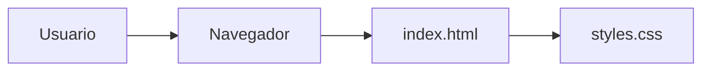
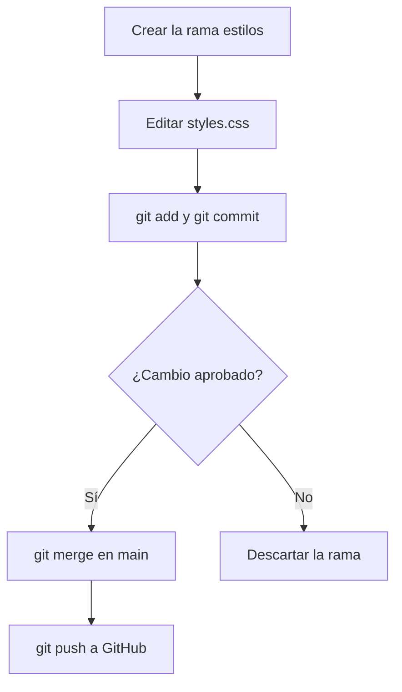

# Control-de-Version


Página web mínima en HTML y CSS creada en el Laboratorio 01 de Desarrollo de Aplicaciones Web Avanzado (Tecsup) para practicar control de versiones con Git y GitHub.
Está pensada para estudiantes que dan sus primeros pasos con commits, ramas, `merge` y `.gitignore`, y que necesitan un repositorio pequeño con un historial fácil de leer.

## Tabla de contenidos

- [Control-de-Version](#control-de-version)
  - [Tabla de contenidos](#tabla-de-contenidos)
  - [Características](#características)
  - [Instalación](#instalación)
  - [Uso](#uso)
  - [Arquitectura](#arquitectura)
  - [Flujo de trabajo con ramas](#flujo-de-trabajo-con-ramas)
  - [Estructura del proyecto](#estructura-del-proyecto)
  - [Hoja de ruta](#hoja-de-ruta)
  - [Contribución](#contribución)
  - [Licencia](#licencia)
  - [Autor](#autor)

## Características

| Archivo        |                  Función                  |   Estado |
|:---------------|:-----------------------------------------:|---------:|
| `index.html`   | Página con título, descripción y autor    | Listo    |
| `styles.css`   | Tipografía, fondo y estilo del título     | Listo    |
| `.gitignore`   | Excluye `node_modules/`, `.vscode/` y `.env` | Listo |
| `README.md`    | Documentación del proyecto                | Listo    |

## Instalación

No necesitas instalar dependencias. Solo requieres [Git](https://git-scm.com/downloads) y un navegador web.

Clona el repositorio y entra a la carpeta:

```bash
git clone https://github.com/paoloescalante-ctrl/Control-de-Version.git
cd Control-de-Version
```

## Uso

Abre `index.html` en tu navegador. En Windows puedes hacerlo desde la terminal:

```powershell
start index.html
```

La página enlaza la hoja de estilos desde el `<head>`:

```html
<link rel="stylesheet" href="styles.css">
```

Para cambiar el aspecto del título, edita la regla `h1` en `styles.css`:

```css
h1 {
  color: #0072ce;
  text-align: center;
  border-bottom: 3px solid #0072ce;
  padding-bottom: 10px;
}
```

## Arquitectura

El navegador carga `index.html`, y este archivo enlaza `styles.css` para aplicar los estilos. No hay servidor ni base de datos.



## Flujo de trabajo con ramas

Los cambios de estilo se desarrollaron en la rama `estilos` y solo llegaron a `main` después de unirlos con `merge`.



## Estructura del proyecto

```text
Control-de-Version/
├── index.html
├── styles.css
├── .gitignore
├── CONTRIBUTING.md
├── LICENSE
└── README.md
```

## Hoja de ruta

- [x] Estructura inicial del proyecto
- [x] Párrafo descriptivo en `index.html`
- [x] Estilos del título desarrollados en la rama `estilos`
- [x] Archivo `.gitignore`
- [x] Autor y grupo en `index.html`
- [x] README profesional y guía de contribución
- [ ] Agregar más páginas al sitio
- [ ] Publicar el sitio con GitHub Pages

## Contribución

Las contribuciones son bienvenidas. Antes de enviar cambios, lee la [guía de contribución](CONTRIBUTING.md) para conocer el flujo de trabajo y el formato de los commits.

## Licencia

Distribuido bajo la licencia MIT. Consulta el archivo [LICENSE](LICENSE) para más información.

## Autor

**Paolo Renato Escalante Butrón**, estudiante de Tecsup, curso Desarrollo de Aplicaciones Web Avanzado, grupo A.
GitHub: [@paoloescalante-ctrl](https://github.com/paoloescalante-ctrl)